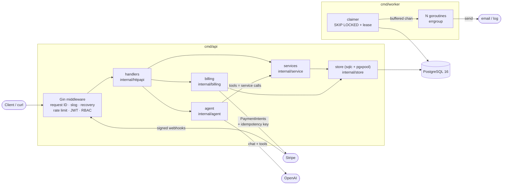
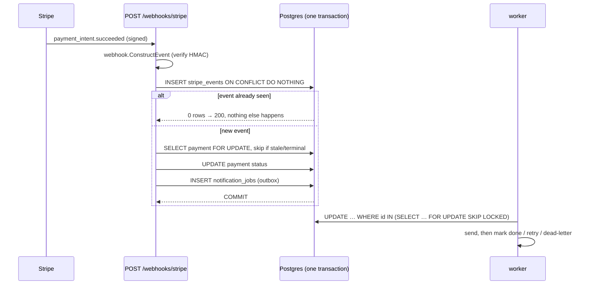

# AssetFlow

[](https://github.com/jenish0908/assetflow/actions/workflows/ci.yml)

An asset-management API in Go. Companies track laptops, monitors and phones,
allocate them to people, take payments through Stripe, notify users from a
background worker, and drive all of it in plain English through an LLM agent.

Every performance number in this README comes from a script in [`scripts/`](scripts)
whose raw output is committed in [`docs/perf-results/`](docs/perf-results).

**Stack:** Go 1.22+ · Gin · PostgreSQL 16 · pgx/v5 · sqlc · golang-migrate ·
stripe-go · OpenAI tool calling · testify · goleak · Docker (distroless) ·
GitHub Actions

## Highlights

| | |
|---|---|
| **N+1 fixed and measured** | `GET /assets` went from 52 to 3 DB queries per request; p95 **124 ms → 27 ms**, throughput **292 → 1,433 req/s** ([details](docs/perf.md#m3-n1-on-get-assets-and-the-fix)) |
| **Stripe without double charges** | Idempotency keys + signature-verified webhooks deduped by event ID in the same transaction as their side effects. Fault-injection reconciliation: **387 problems (47 double charges) → 0** ([details](docs/perf.md#m4-stripe-billing-before-and-after-idempotency--webhook-dedupe)) |
| **Job worker** | `FOR UPDATE SKIP LOCKED` + leases, bounded goroutine pool under `errgroup`, retries with backoff, dead-lettering, graceful SIGTERM shutdown. **39 → 2,260 jobs/sec** from 1 to 64 goroutines, zero duplicates ([details](docs/perf.md#m5-notification-worker-throughput)) |
| **LLM agent** | "allocate laptop L-102 to Priya" becomes 6 permission-scoped tools. Roles are checked in Go before execution, arguments strictly validated, reads run in parallel and writes in order, each tool call has its own timeout |
| **Small, locked-down images** | Distroless, static, non-root: api **24.1 MB**, worker **18.5 MB** (vs 1.24 GB build image) |

## Architecture



Requests flow handler → service → store, with each layer depending on an
interface owned by its caller. There is no global state: `main` builds
everything and passes it down.

**Transactional outbox.** An allocation or a successful payment inserts a
`notification_jobs` row *in the same transaction* as the change. The worker
delivers it later, so a notification can never be lost or sent for a change
that rolled back.



## Project layout

```
cmd/
  api/          HTTP server
  worker/       notification worker
  adduser/      create the first admin
  reconcile/    compare Stripe with the database
  billingsim/   fault-injection simulator for billing (M4 numbers)
  notifybench/  worker throughput benchmark (M5 numbers)
internal/
  config/       env → typed config
  httpapi/      Gin router, handlers, middleware, JSON errors
  service/      business rules (assets, users), Store interface
  billing/      Stripe gateway, webhooks, reconciliation, FakeStripe
  notify/       job worker and notification handlers
  agent/        LLM loop, tools, OpenAI client, fake model
  auth/         roles, bcrypt, JWT
  store/        pgxpool + sqlc-generated queries (store/db)
db/
  migrations/   golang-migrate SQL
  queries/      SQL that sqlc compiles to Go
scripts/        seed data, load tests, simulations (every number in docs/)
docs/           perf.md, perf-results/, interview_notes.md
```

## Run it

Needs only Docker. The `make` targets wrap the same commands (`make help`).

```bash
# 1. database + schema
docker compose up -d --wait db
docker compose run --rm migrate up

# 2. first admin (and a viewer to allocate things to)
docker compose run --rm adduser -email admin@assetflow.dev -name Admin -role admin -password 'admin-pass-123'
docker compose run --rm adduser -email priya@assetflow.dev -name Priya -role viewer -password 'priya-pass-123'

# 3. API on :8080 + notification worker
docker compose --profile app up -d --build api worker
curl localhost:8080/readyz          # {"status":"ready"}
```

To develop with a local Go toolchain instead, copy `.env.example` to `.env`
and run `make run-api` and `make run-worker`.

### Configuration

| variable | default | |
|---|---|---|
| `DATABASE_URL` | required | Postgres connection string |
| `JWT_SECRET` | required | at least 32 bytes |
| `HTTP_ADDR` | `:8080` | |
| `LOG_LEVEL` | `info` | `debug`, `info`, `warn`, `error` |
| `RATE_LIMIT_RPS` / `RATE_LIMIT_BURST` | `10` / `20` | per client IP |
| `LIST_STRATEGY` | `batched` | `batched`, `join` or `nplus1` (kept as the perf baseline) |
| `STRIPE_SECRET_KEY` / `STRIPE_WEBHOOK_SECRET` | unset | billing routes are disabled without them |
| `OPENAI_API_KEY` / `OPENAI_MODEL` | unset / `gpt-4o-mini` | without a key the agent uses a built-in deterministic model |
| `WORKER_CONCURRENCY` | `8` | goroutines per worker |
| `SHUTDOWN_TIMEOUT` | `10s` api, `20s` worker | graceful shutdown deadline |

## API

All errors share one shape:
`{"error": {"code": "conflict", "message": "…", "request_id": "…"}}`.

| method | path | role |
|---|---|---|
| `POST` | `/auth/login` | public |
| `POST` | `/users` | admin |
| `GET` | `/assets?limit=&offset=` · `/assets/:id` | viewer |
| `POST` | `/assets` | manager |
| `PATCH` | `/assets/:id` · `/assets/:id/status` | manager |
| `POST` | `/assets/:id/allocate` · `/assets/:id/return` | manager |
| `DELETE` | `/assets/:id` | admin |
| `POST` | `/payments` (optional `Idempotency-Key` header) · `GET /payments/:id` | viewer (owner or admin) |
| `POST` | `/webhooks/stripe` | Stripe signature |
| `POST` | `/agent/chat` | viewer; each tool checked against the caller's role |
| `GET` | `/healthz` · `/readyz` | public |

```bash
TOKEN=$(curl -s -X POST localhost:8080/auth/login \
  -d '{"email":"admin@assetflow.dev","password":"admin-pass-123"}' | jq -r .token)

curl -s -X POST localhost:8080/assets -H "Authorization: Bearer $TOKEN" \
  -d '{"tag":"L-102","name":"MacBook Pro 14","category":"laptop"}'
# {"id":1,"tag":"L-102","name":"MacBook Pro 14","category":"laptop","status":"available",...}

curl -s -X POST localhost:8080/agent/chat -H "Authorization: Bearer $TOKEN" \
  -d '{"message":"allocate laptop L-102 to Priya"}'
# {"reply":"Allocated L-102 to Priya (priya@assetflow.dev).",
#  "tool_calls":[{"step":1,"name":"allocateAsset","arguments":"{\"asset_tag\":\"L-102\",\"user\":\"Priya\"}","ok":true,...}]}

curl -s -X POST localhost:8080/assets/1/allocate -H "Authorization: Bearer $TOKEN" -d '{"user_id":2}'
# {"error":{"code":"conflict","message":"asset 1 is allocated, not available","request_id":"…"}}

curl -s "localhost:8080/assets?limit=2" -H "Authorization: Bearer $TOKEN"
# {"items":[{"id":1,...,"allocations":[{"id":1,"asset_id":1,"user_id":2,...}]}],"limit":2,"offset":0,"total":1}

docker compose --profile app logs worker | grep "notification sent"
# {"level":"INFO","msg":"notification sent","user_id":2,"subject":"Asset allocated to you","key":"job-1",...}
```

A viewer who asks the agent to allocate gets *"permission denied: allocateAsset
requires role manager or higher"*: the check happens in Go, whatever the model
decides to call.

## Performance

Full methodology, environment and caveats are in **[docs/perf.md](docs/perf.md)**.
Each section names the script that produced it; raw outputs are in
[docs/perf-results/](docs/perf-results). Measured on one 8-CPU machine with
everything in Docker, so compare ratios rather than absolute numbers.

| | before | after | script |
|---|---:|---:|---|
| `GET /assets` p95 latency | 123.7 ms | **27.0 ms** | `scripts/perf_list_assets.sh` |
| `GET /assets` throughput | 292 req/s | **1,433 req/s** | 〃 |
| DB queries per request | 52 | **3** | 〃 (`pg_stat_statements`) |
| Billing problems, fault-injection sim\* | 387 (47 double charges) | **0** | `scripts/billing_sim.sh` |
| Worker throughput, 20 ms jobs | 39 jobs/s (1 goroutine) | **2,260 jobs/s** (64) | `scripts/notify_throughput.sh` |

\* Real API, Postgres and webhook signature verification against an
in-memory Stripe fake that injects lost responses and duplicate, reordered
webhooks. See [docs/perf.md](docs/perf.md#m4-stripe-billing-before-and-after-idempotency--webhook-dedupe).

## Testing

```bash
make test               # unit tests, -race
make test-integration   # + integration tests against Postgres
make lint               # golangci-lint, same version and config as CI
```

- Table-driven tests with testify, and hand-written interface mocks that
  embed the interface, so an unexpected call panics.
- Integration tests against real Postgres: concurrent allocation (exactly one
  wins), the same webhook delivered 2 and 10 times at once (processed once),
  two workers sharing a queue (no job twice), lease expiry and fencing.
- `goleak.VerifyTestMain` in the worker and agent packages: no goroutine may
  outlive a test.
- CI ([`.github/workflows/ci.yml`](.github/workflows/ci.yml)): golangci-lint,
  `sqlc diff` (generated code is current), `go test -race` on Go 1.22 and
  1.23 with a Postgres service, and image builds for api and worker.

## Docker images

Multi-stage build: `golang:1.23` compiles a static binary (`CGO_ENABLED=0`,
`-trimpath -ldflags="-s -w"`), copied into `gcr.io/distroless/static-debian12:nonroot`,
which has no shell or package manager and runs as non-root.

| image | size (`docker image ls`) | compressed | binary |
|---|---:|---:|---:|
| `assetflow-api` | **24.1 MB** | 5.4 MB | 13.3 MB |
| `assetflow-worker` | **18.5 MB** | 4.0 MB | 9.1 MB |
| `golang:1.23` (build stage only) | 1.24 GB | 303 MB | n/a |

Re-measure with `make docker-build`.

## Learn from it

[`docs/interview_notes.md`](docs/interview_notes.md) explains every concept
used here (goroutines, channels, context, errgroup, idempotency, SKIP LOCKED,
graceful shutdown, pgx, sqlc, distroless and more), with where it appears in
the code and the questions interviewers ask about it.
